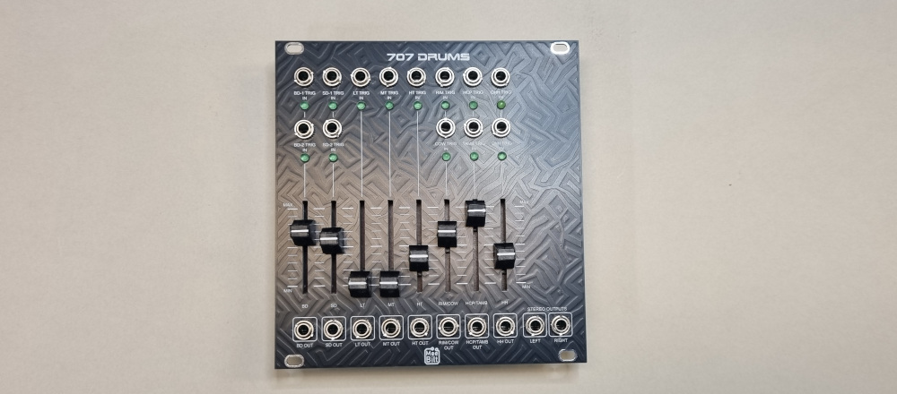

# 707drums

707drums is a Eurorack module that emulates the unique TR-707 Drum voices. The cymbals are not included, since the TR-707 has basically the same Crash and Ride as the TR-909; see 909-cymbals (https://github.com/tkilla64/eurorack/tree/main/909-cymbals).

The design consists of a main board, a voice board and a RP2040 Prototype board (https://github.com/tkilla64/eurorack/tree/main/rp2040_proto).

### Inputs
The module has 13 individual trig-inputs for each sound. Each input jack has a corresponding LED which will flash when the sound is triggered. The low-to-high transition will trigger the sound.

BD-1 TRIG IN  
BD-2 TRIG IN  
SD-1 TRIG IN  
SD-2 TRIG IN  
LT TRIG IN  
MT TRIG IN  
HT TRIG IN  
RIM TRIG IN  
COW TRIG IN  
HCP TRIG IN  
TAMB TRIG IN  
OHH TRIG IN  
CHH TRIG IN  

### Outputs
The 707 DRUMS module has 8 individual output jacks for each voice.

BD OUT  
SD OUT  
LT OUT  
MT OUT  
HT OUT  
RIM/COW OUT  
HCP/TAMB OUT  
HH OUT  

The module also has two stereo outputs, where some of the voice have a fixed panning.

LEFT OUT  
RIGHT OUT

### Slider Potentiometers
Each voice have a slider pot to control the output level.

### Supply
10-pin power connector:  
+12 VDC @ 100 mA  
-12 VDC @ 30 mA

### Dimensions
Height: 3U  
Width:  24HP  
Depth:  33 mm

### YouTube video
[Eurorack DIY: 707 Drums - The Voice Board (ep1)](https://youtu.be/Pr6guDPABbc)  
[Eurorack DIY: 707 Drums - The Main Board (ep2)](https://youtu.be/YWh-ssBz8bM)
